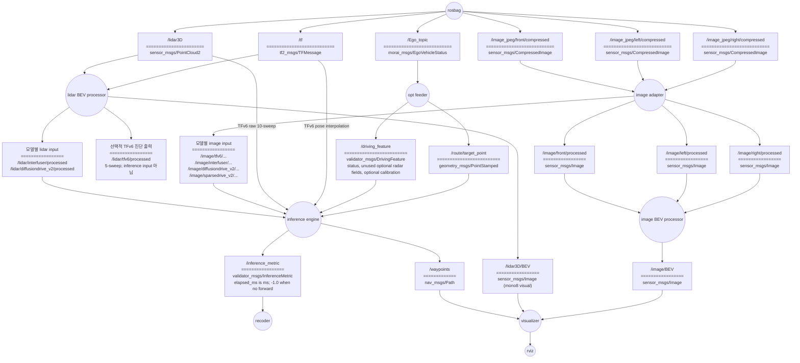

# E2E-OpenLoop-ROS-Validator
openloop validator for e2e AV models based on ROS1 noetic

TFv6 / InterFuser / DiffusionDrive v2 / SparseDrive v2 에 대응

## 0. Convention
### branch rule
main에 merge, PR하지 말것. 코드 리뷰 후에 진행.
기능 개발시 브랜치 파서 진행 합니다.
브랜치 이름은 `feature/name`를 따른다. 
- 예시: `inference_engine-data_buffer/taeyun`
### commets
코드 최상단에 코드의 역할과 구독, 발행하는 토픽을 비롯한 i/o 적기.
- 예시:
```
"""
inference engine의 인풋이 되는 데이터를 저장하는 버퍼 객체
토픽을 callback으로 객체 내부에 저장.
pub:
sub: 
    /lidar/<model profile>/...
    /image/<model profile>/...
    /Ego_topic
    /driving_feature
    /route/target_point (필요한 profile만)
    /lidar3D (TFv6 10-sweep history인 경우만)
"""
```

## 1. File Structure
```
E2E-OpenLoop-ROS-Validator/
├── src/
│   ├── MORAI-ROS_morai_msgs
│   └── Validator_pkg/                 # Catkin package group (package.xml 없음)
│       ├── config/profile.json         # 세 layer가 공유하는 model contract
│       ├── validator_inference/        # ROS package: validator_inference
│       ├── validator_msgs/             # ROS package: validator_msgs
│       └── validator_pipeline/         # ROS package: Validator_pkg
├── rosbag/
├── models/               # 다운로드한 checkpoint와 auxiliary asset; Git 미추적
└── records/
    └── openloop/  # 평가별 inference_YYYYMMDDTHHMMSS+0900_{model_id}.csv
```
`src/Validator_pkg` 자체는 package manifest를 두지 않는 그룹 디렉터리다. Catkin은 안의 세 sibling package를 각각 발견하며, preprocessing/visualization launch의 ROS package 이름은 기존 호환을 위해 `Validator_pkg`를 유지한다.
`rosbag/`에 [2026-07-16-17-13-14.bag](https://drive.google.com/drive/folders/1IBFk-q1ZYYRfLVi6TD8P2BgOuWAzudab?usp=share_link)저장.

## 2. Architecture


ROS관례에 따라 노드는 원, 토픽은 사각형으로 그림.
토픽의 ====== 위는 토픽의 이름, 아래는 토픽의 타입

### 2.1 preprocessing layer
`lidar BEV processor`, `image adaptor`, `image BEV processor` 노드로 구성됨.
raw data를 가공하여 `inference engine`과 `visualizer`에 서빙하는 계층.
- 책임: raw data를 모델이 기대하는 포멧으로 preprocessing 및 발행, visualizer가 기대하는 image BEV 가공 및 발행.
- 4개 모델에 대응 가능해야 함.

`lidar BEV processor`, `image adaptor` 노드는 모델이 기대하는 입력 포멧에 맞춰 임의로 토픽 추가, 변경.
카메라 rosbag 토픽은 `/image_jpeg/front/compressed`, `/image_jpeg/left/compressed`, `/image_jpeg/right/compressed`이다. `image adaptor`가 각각 `/image/front/processed`, `/image/left/processed`, `/image/right/processed`로 변환하고, `camera_bev_stitcher`가 세 영상을 공통 차량 좌표계에 투영해 `/image/BEV`로 발행한다.

#### 2.1.1 Camera topic contract

카메라 입력 토픽은 rosbag에 기록된 다음 토픽을 기준으로 한다.

| Camera | Input topic | Type |
| --- | --- | --- |
| Front | `/image_jpeg/front/compressed` | `sensor_msgs/CompressedImage` |
| Left | `/image_jpeg/left/compressed` | `sensor_msgs/CompressedImage` |
| Right | `/image_jpeg/right/compressed` | `sensor_msgs/CompressedImage` |

`image_adaptor`는 선택한 모델과 무관하게 다음 legacy 토픽을 항상 발행한다. 이 토픽들은 원본 해상도와 header를 유지하는 `bgr8` 영상이며 `camera_bev_stitcher`의 입력으로 사용한다.

| Camera | Legacy output topic | Encoding |
| --- | --- | --- |
| Front | `/image/front/processed` | `bgr8` |
| Left | `/image/left/processed` | `bgr8` |
| Right | `/image/right/processed` | `bgr8` |

추론용 영상은 모델마다 크기와 인코딩이 다르므로 `/image/main/processed` 하나를 공유하지 않고 모델별 namespace로 분리한다.

| Model profile | Model input topic | Size (W x H) | Encoding / value |
| --- | --- | --- | --- |
| TFv6 | `/image/tfv6/processed` | 1152 x 384 | `rgb8`, left-front-right |
| InterFuser | `/image/interfuser/front` | 224 x 224 | `32FC3`, ImageNet-normalized RGB |
| InterFuser | `/image/interfuser/left` | 128 x 128 | `32FC3`, ImageNet-normalized RGB |
| InterFuser | `/image/interfuser/right` | 128 x 128 | `32FC3`, ImageNet-normalized RGB |
| InterFuser | `/image/interfuser/center` | 128 x 128 | `32FC3`, ImageNet-normalized RGB |
| DiffusionDrive v2 | `/image/diffusiondrive_v2/processed` | 1024 x 256 | `32FC3`, RGB `[0, 1]` |
| SparseDrive v2 | `/image/sparsedrive_v2/front` | 512 x 256 | `32FC3`, ImageNet-normalized RGB |
| SparseDrive v2 | `/image/sparsedrive_v2/left` | 512 x 256 | `32FC3`, ImageNet-normalized RGB |
| SparseDrive v2 | `/image/sparsedrive_v2/right` | 512 x 256 | `32FC3`, ImageNet-normalized RGB |

`~model_profiles` 파라미터로 필요한 모델 출력을 선택한다. 기본값 `raw`는 legacy 토픽만 발행하며, `all`은 네 모델 출력을 모두 활성화한다.

```bash
rosrun Validator_pkg image_adaptor.py _model_profiles:=tfv6
rosrun Validator_pkg image_adaptor.py _model_profiles:=interfuser
rosrun Validator_pkg image_adaptor.py _model_profiles:=diffusiondrive_v2
rosrun Validator_pkg image_adaptor.py _model_profiles:=sparsedrive_v2
rosrun Validator_pkg image_adaptor.py _model_profiles:=all
```

`camera_bev_stitcher`는 legacy 카메라 토픽 세 개를 동기화하고 `/image/BEV`로 발행한다. 출력은 전방 25 m, 좌우 총 30 m를 0.05 m/pixel로 표현한 600 x 500 `bgr8` 영상이다. 따라서 모델이 stitched image를 사용하더라도 legacy left/right 토픽은 BEV 시각화를 위해 계속 발행한다.

#### 2.1.2 LiDAR topic contract

`lidar_bev_processor`는 rosbag의 `/lidar3D`를 입력으로 받아 시각화 BEV와 InterFuser/DiffusionDrive V2 추론 입력을 만든다. 선택적 TFv6 진단 출력을 만들 때는 `/tf`도 사용한다. TFv6의 실제 추론 LiDAR 경로는 이 노드와 독립적으로 inference layer가 책임진다.

| Input topic | Type | Purpose |
| --- | --- | --- |
| `/lidar3D` | `sensor_msgs/PointCloud2` | 현재 LiDAR point cloud |
| `/tf` | `tf2_msgs/TFMessage` | 선택적 5-sweep 진단 출력 정렬; TFv6 inference의 raw 10-sweep pose interpolation |

시각화용 `/lidar3D/BEV`는 선택한 모델과 무관하게 항상 발행한다. 카메라 BEV와 동일하게 전방 25 m, 좌우 총 30 m를 0.05 m/pixel로 표현하며, 크기는 600 x 500이고 encoding은 `mono8`이다. 이 토픽은 visualizer용이며 모델 추론 입력으로 사용하지 않는다.

전처리 LiDAR 출력은 아래와 같다. InterFuser와 DiffusionDrive V2 출력은 모델 입력이고, TFv6 출력은 전처리 동작을 비교하기 위한 선택적 진단용이다.

| Model profile | Preprocessing output | Size (W x H) | Encoding / value | Consumer / processing |
| --- | --- | --- | --- | --- |
| TFv6 | `/lidar/tfv6/processed` | 384 x 320 | `32FC1`, density `[0, 1]` | 선택적 진단용 5-sweep motion compensation/ground removal; inference는 구독하지 않음 |
| InterFuser | `/lidar/interfuser/processed` | 224 x 224 | `32FC3`; below/above `[0, 1]`, total `[0, 2]` | height-separated histogram |
| DiffusionDrive v2 | `/lidar/diffusiondrive_v2/processed` | 256 x 256 | `32FC1`, above-ground density `[0, 1]` | ground-relative histogram |
| SparseDrive v2 | 발행하지 않음 | - | - | camera-only profile |

InterFuser histogram은 고정 source와 동일하게 `xbins=np.linspace(-28,29,225)`, `ybins=np.linspace(-28,0,225)`를 사용해 각 축에 225개 edge/224개 bin을 만든다. x 끝값 29는 의도된 계약이며 28로 바꾸지 않는다.

좌표 변환에는 `validator_pipeline/config/0716demo.json`과 공유 profile의 LiDAR 장착 위치 `(x=2.0, y=0.0, z=1.5)`를 사용한다. TFv6 inference는 `/lidar3D`의 시간순 raw `PointCloud2` 10개를 직접 FIFO에 보관한다. 각 sweep stamp에서 `/tf`의 `map` → `base_link` pose를 translation 선형 보간과 quaternion SLERP로 구한 뒤 최신 causal anchor로 정렬하고, 고정된 LEAD builder의 ego mask·ground removal·rasterization 순서를 적용한다. 따라서 `/lidar/tfv6/processed` 5-sweep 영상은 TFv6 model input이 아니다.

카메라와 LiDAR의 `~model_profiles`는 launch 인자 하나로 함께 선택한다. 기본값 `raw`는 legacy 카메라 토픽과 시각화용 LiDAR BEV만 발행하고, `all`은 지원하는 모든 모델별 전처리 토픽을 활성화한다.

```bash
# 전체 preprocessing layer 실행
roslaunch Validator_pkg camera_bev_pipeline.launch model_profiles:=all show_gui:=false

# 모델 하나만 선택하는 예시
roslaunch Validator_pkg camera_bev_pipeline.launch model_profiles:=tfv6 show_gui:=false
```

SparseDrive v2를 선택해도 `/lidar3D/BEV`는 시각화를 위해 발행하지만, SparseDrive 추론용 LiDAR 토픽은 만들지 않는다.

#### 2.1.3 Camera/LiDAR BEV overlay validation

`bev_overlay_viewer`는 `/image/BEV`와 `/lidar3D/BEV`를 header stamp 기준으로 동기화하고, LiDAR를 컬러로 변환해 카메라 위에 겹친 `/image/BEV_overlay`를 발행한다. 이 노드는 검증 전용이며 전처리 또는 모델 입력 토픽을 변경하지 않는다.

| Output topic | Type | Purpose |
| --- | --- | --- |
| `/image/BEV_overlay` | `sensor_msgs/Image` (`bgr8`, 600 x 500) | synchronized camera/LiDAR overlay |
| `/bev_overlay/header_delay_ms` | `std_msgs/Float32` | camera stamp - LiDAR stamp |
| `/bev_overlay/arrival_delay_ms` | `std_msgs/Float32` | camera ROS arrival - LiDAR ROS arrival |

음수 지연은 카메라가 LiDAR보다 먼저 기록되거나 도착했다는 뜻이고, 양수는 카메라가 나중이라는 뜻이다. arrival delay는 rosbag 재생 속도와 현재 컴퓨터의 처리 부하에도 영향을 받는다.

전체 파이프라인과 오버레이 노드를 함께 실행한다.

```bash
roslaunch Validator_pkg camera_bev_pipeline.launch \
  model_profiles:=all \
  show_gui:=false \
  enable_bev_overlay:=true
```

rosbag을 재생한 뒤 `rqt_image_view`에서 `/image/BEV_overlay`를 선택한다.

```bash
rqt_image_view
```

파이프라인을 별도로 실행한 상태에서는 오버레이 노드만 직접 실행할 수도 있다.

```bash
rosrun Validator_pkg bev_overlay_viewer.py
```

### 2.2 inference layer
`opt feeder`, `inference engine`, `recoder`로 구성됨.
4개 모델에 대한 추론 루프. 모델의 추론 결과 waypoints를 발행한다.
`recoder`는 추론 시간과 매 10 Hz tick의 상태를 CSV로 기록한다. `inference_completed`, `not_ready`, `busy_tick_skipped`가 모두 기록되며, 평가마다 `records/openloop/`에 timestamp·model ID가 포함된 새 CSV가 생성된다.
- `opt feeder`는 `/Ego_topic`과 로컬 `profile.json`을 읽어 velocity/acceleration, profile-specific driving feature, fallback command를 `/driving_feature`로 발행한다. 선택된 TFv6 `noradar_resnet34` checkpoint는 radar를 읽지 않으므로 radar vector와 shape을 비워 발행하고, SparseDrive V2는 profile 내부 calibration을 같은 message에 담는다. TFv6/InterFuser처럼 target point가 필요한 profile에는 해당 `/route/target_point*`를 발행한다.
- `inference engine`의 `InputBuffer`는 profile 입력을 저장하고 10 Hz causal snapshot을 selected model에 전달한다. 각 input은 `/driving_feature.header.stamp` 이하의 최신 sample만 사용하며, non-history input은 current/previous 두 개를, TFv6만 raw `/lidar3D` 10-sweep FIFO와 timestamp별 pose history를 유지한다.
- `InferenceWorker`는 한 번에 하나의 model forward만 실행한다. worker가 busy인 tick은 대기시키지 않고 `busy_tick_skipped`로 기록하고, 완료 결과는 one-slot mailbox로 다음 tick에 publish한다.
- 책임: opt feeder의 auxiliary input 생성, 추론 루프 구동 및 waypoints 발행, 추론 시간과 입력 age를 포함한 평가 기록.

구현 전 설계는 [Inference Engine 설계](docs/inference_engine_design.md), 모델별 실제 tensor/asset 계약은 [Model I/O Contracts](docs/model_io_contracts.md)에 정리한다.

### 2.3 visualization layer
`visualizer`노드로 구성됨.
lidar BEV, Image BEV, waypoints를 overlap하여 시각화.
두 BEV는 `base_link` 기준 600 x 500, x=[0,25] m, y=[-15,15] m, 0.05 m/pixel 계약을 공유한다. Inference가 발행하는 `/waypoints`는 `Lidar3D-4` frame이므로 visualizer가 profile의 `T_base_from_lidar`(평행이동 `[2,0,1.5]`, identity quaternion)를 적용해 `base_link` BEV에 표시한다.

## 3. Open-loop 실행

아래는 InterFuser 예시다. 첫 명령으로 모델 환경을 만들고 validator와 RViz를 시작한 뒤, 다른 terminal에서 기본 bag을 재생한다. `interfuser` 대신 `tfv6`, `diffusiondrive_v2`, `sparsedrive_v2`를 넣어도 같은 절차로 실행된다.

```bash
./openloop setup interfuser
./openloop interfuser --rviz
./openloop bag
```

`setup`은 모델별 고정 Python/CUDA dependency를 `.venvs/<model>/builds/`에 만들고 검증이 끝난 build만 `current`로 선택한다. `run`과 모델 shorthand는 환경을 설치하거나 변경하지 않는다. 전체 hash 무결성 검사와 이전 build 정리는 각각 다음 명령을 사용한다.

지원 host는 Ubuntu 20.04 x86_64, ROS Noetic, `uv 0.11.14`이다. SparseDrive V2 setup은 해시가 고정된 최소 CUDA 11.8 compiler를 프로젝트의 `.toolchains/`에 자동 준비하므로 별도 `sudo` 설치나 `CUDA_HOME` 설정이 필요 없다.

```bash
./openloop verify interfuser
./openloop prune interfuser
```

네 모델 모두 source, runtime asset, dependency lock, 실제 model load까지 setup/verify 대상이다. InterFuser checkpoint는 공식 배포본으로 가장하지 않고 Drivora 호환 mirror의 `third-party compatibility artifact`로 hash와 provenance를 고정한다. 자세한 준비 조건, 직접 launch, 오류 복구 절차는 [Open-loop 운영 절차](docs/openloop_validator.md)를 참고한다.

고급 사용자가 launch 인자를 직접 제어할 때는 setup을 먼저 완료하고 절대 환경 root를 전달한다.

```bash
roslaunch Validator_pkg openloop_validator.launch \
  project_root:=/home/stier/E2E-OpenLoop-ROS-Validator \
  model_id:=interfuser \
  model_env_root:=/home/stier/E2E-OpenLoop-ROS-Validator/.venvs \
  show_rviz:=true
```

기본 결과 위치는 프로젝트의 `records/openloop/`이다. 고급 직접 launch에서는 `profile_file:=/absolute/profile.json`, `record_dir:=/absolute/records`로 로컬 경로를 바꿀 수 있다. `/waypoints`는 `Lidar3D-4` frame이고 매 tick 결과는 `/inference_metric` 하나를 통해 CSV에 기록된다.
