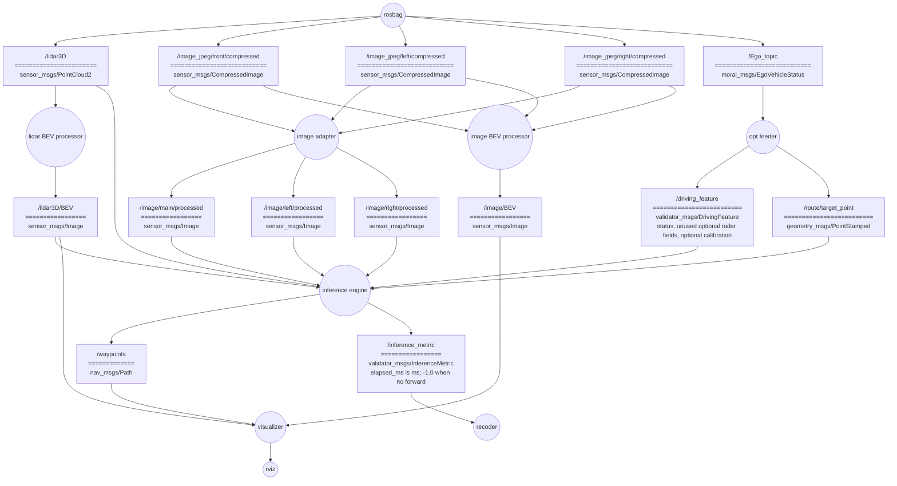

# E2E-OpenLoop-ROS-Validator
openloop validator for e2e AV models based on ROS1 noetic

TFv6 / InterFuser / DiffusionDrive v2 / SparseDrive v2 에 대응

## 0. Convention
### branch rule
main에 merge, PR하지 말것. 코드 리뷰 후에 진행.
기능 개발시 브랜치 파서 진행 합니다.
브랜치 이름은 `feature/name`를 따른다. 
- 예시: `inference_engine-data_buffer/taeyun`
### commets
코드 최상단에 코드의 역할과 구독, 발행하는 토픽을 비롯한 i/o 적기.
- 예시:
```
"""
inference engine의 인풋이 되는 데이터를 저장하는 버퍼 객체
토픽을 callback으로 객체 내부에 저장.
pub:
sub: 
    profile별 perception topic
    /driving_feature
    /route/target_point (필요한 profile만)
    /lidar3D (TFv6 10-sweep history인 경우만)
"""
```

## 1. File Structure
```
E2E-OpenLoop-ROS-Validator/
├── src/
│   ├── MORAI-ROS_morai_msgs
│   └── Validator_pkg
├── rosbag/
├── models/               # 다운로드한 checkpoint와 auxiliary asset; Git 미추적
└── records/
    └── openloop/  # 평가별 inference_YYYYMMDDTHHMMSS+0900_{model_id}.csv
```
코드 파일은 Validator_pkg 밑에 둘 것.
`rosbag/`에 [2026-07-16-17-13-14.bag](https://drive.google.com/drive/folders/1IBFk-q1ZYYRfLVi6TD8P2BgOuWAzudab?usp=share_link)저장.

## 2. Architecture


ROS관례에 따라 노드는 원, 토픽은 사각형으로 그림.
토픽의 ====== 위는 토픽의 이름, 아래는 토픽의 타입

### 2.1 preprocessing layer
`lidar BEV processor`, `image adaptor`, `image BEV processor` 노드로 구성됨.
raw data를 가공하여 `inference engine`과 `visualizer`에 서빙하는 계층.
- 책임: raw data를 모델이 기대하는 포멧으로 preprocessing 및 발행, visualizer가 기대하는 image BEV 가공 및 발행.
- 4개 모델에 대응 가능해야 함.

`lidar BEV processor`, `image adaptor` 노드는 모델이 기대하는 입력 포멧에 맞춰 임의로 토픽 추가, 변경.
`/image_jpeg/front/compressed`, `/image_jpeg/left/compressed`, `/image_jpeg/right/compressed`를 stitch하는 경우 `/image/main/processed`로 발행하고 `/image/left/processed`, `/image/right/processed`는 발행하지 않도록 함.

### 2.2 inference layer
`opt feeder`, `inference engine`, `recoder`로 구성됨.
4개 모델에 대한 추론 루프. 모델의 추론 결과 waypoints를 발행한다.
`recoder`는 추론 시간과 매 10 Hz tick의 상태를 CSV로 기록한다. `inference_completed`, `not_ready`, `busy_tick_skipped`가 모두 기록되며, 평가마다 `records/openloop/`에 timestamp·model ID가 포함된 새 CSV가 생성된다.
- `opt feeder`는 `/Ego_topic`과 로컬 `profile.json`을 읽어 velocity/acceleration, profile-specific driving feature, fallback command를 `/driving_feature`로 발행한다. 선택된 TFv6 `noradar_resnet34` checkpoint는 radar를 읽지 않으므로 radar vector와 shape을 비워 발행하고, SparseDrive V2는 profile 내부 calibration을 같은 message에 담는다. TFv6/InterFuser처럼 target point가 필요한 profile에는 해당 `/route/target_point*`를 발행한다.
- `inference engine`의 `InputBuffer`는 profile 입력을 저장하고 10 Hz causal snapshot을 selected model에 전달한다. 각 input은 `/driving_feature.header.stamp` 이하의 최신 sample만 사용하며, non-history input은 current/previous 두 개를, TFv6만 raw `/lidar3D` 10-sweep FIFO와 timestamp별 pose history를 유지한다.
- `InferenceWorker`는 한 번에 하나의 model forward만 실행한다. worker가 busy인 tick은 대기시키지 않고 `busy_tick_skipped`로 기록하고, 완료 결과는 one-slot mailbox로 다음 tick에 publish한다.
- 책임: opt feeder의 auxiliary input 생성, 추론 루프 구동 및 waypoints 발행, 추론 시간과 입력 age를 포함한 평가 기록.

구현 전 설계는 [Inference Engine 설계](docs/inference_engine_design.md), 모델별 실제 tensor/asset 계약은 [Model I/O Contracts](docs/model_io_contracts.md)에 정리한다.

### 2.3 visualization layer
`visualizer`노드로 구성됨.
lidar BEV, Image BEV, waypoints를 overlap하여 시각화.

## 3. Open-loop 실행

아래 예시는 `interfuser`를 선택한다. 다른 모델은 세 명령의 model ID를 동일하게 바꾼다. SparseDrive V2는 실행 전에 `src/Validator_pkg/config/profile.json`의 세 camera calibration을 모두 채워야 한다.

```bash
catkin_make
source devel/setup.bash
rosrun validator_inference fetch_model_assets.py --model-id interfuser
roslaunch validator_inference openloop_inference.launch model_id:=interfuser
```

launch는 `/use_sim_time=true`를 설정하고 OptFeeder, InferenceEngine, Recorder 세 노드만 시작한다. PreprocessLayer를 실행한 뒤 다른 terminal에서 bag clock과 함께 재생한다.

```bash
source devel/setup.bash
rosbag play --clock rosbag/2026-07-16-17-13-14.bag
```

기본 결과 위치는 프로젝트의 `records/openloop/`이며 launch 인자 `profile_file:=...`, `record_dir:=...`로 로컬 경로를 바꿀 수 있다. `/waypoints`는 `Lidar3D-4` frame이고 매 tick 결과는 `/inference_metric` 하나를 통해 CSV에 기록된다.
