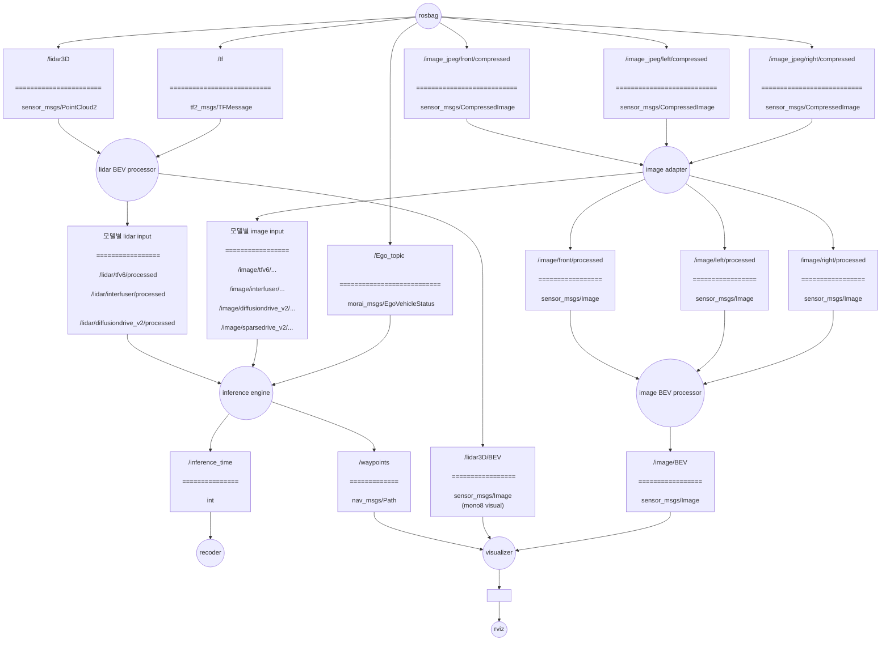

# E2E-OpenLoop-ROS-Validator
openloop validator for e2e AV models based on ROS1 noetic

TFv6 / InterFuser / DiffusionDrive v2 / SparseDrive v2 에 대응

## 0. Convention
### branch rule
main에 merge, PR하지 말것. 코드 리뷰 후에 진행.
기능 개발시 브랜치 파서 진행 합니다.
브랜치 이름은 `feature/name`를 따른다. 
- 예시: `inference_engine-data_buffer/taeyun`
### commets
코드 최상단에 코드의 역할과 구독, 발행하는 토픽을 비롯한 i/o 적기.
- 예시:
```
"""
inference engine의 인풋이 되는 데이터를 저장하는 버퍼 객체
토픽을 callback으로 객체 내부에 저장.
pub:
sub: 
    /lidar/<model profile>/...
    /image/<model profile>/...
    /Ego_topic
"""
```

## 1. File Structure
```
E2E-OpenLoop-ROS-Validator/
├── src/
│   ├── MORAI-ROS_morai_msgs
│   └── Validator_pkg
└── rosbag/
```
코드 파일은 Validator_pkg 밑에 둘 것.
`rosbag/`에 [2026-07-16-17-13-14.bag](https://drive.google.com/drive/folders/1IBFk-q1ZYYRfLVi6TD8P2BgOuWAzudab?usp=share_link)저장.

## 2. Architecture


ROS관례에 따라 노드는 원, 토픽은 사각형으로 그림.
토픽의 ====== 위는 토픽의 이름, 아래는 토픽의 타입

### 2.1 preprocessing layer
`lidar BEV processor`, `image adaptor`, `image BEV processor` 노드로 구성됨.
raw data를 가공하여 `inference engine`과 `visualizer`에 서빙하는 계층.
- 책임: raw data를 모델이 기대하는 포멧으로 preprocessing 및 발행, visualizer가 기대하는 image BEV 가공 및 발행.
- 4개 모델에 대응 가능해야 함.

`lidar BEV processor`, `image adaptor` 노드는 모델이 기대하는 입력 포멧에 맞춰 임의로 토픽 추가, 변경.
카메라 rosbag 토픽은 `/image_jpeg/front/compressed`, `/image_jpeg/left/compressed`, `/image_jpeg/right/compressed`이다. `image adaptor`가 각각 `/image/front/processed`, `/image/left/processed`, `/image/right/processed`로 변환하고, `camera_bev_stitcher`가 세 영상을 공통 차량 좌표계에 투영해 `/image/BEV`로 발행한다.

#### 2.1.1 Camera topic contract

카메라 입력 토픽은 rosbag에 기록된 다음 토픽을 기준으로 한다.

| Camera | Input topic | Type |
| --- | --- | --- |
| Front | `/image_jpeg/front/compressed` | `sensor_msgs/CompressedImage` |
| Left | `/image_jpeg/left/compressed` | `sensor_msgs/CompressedImage` |
| Right | `/image_jpeg/right/compressed` | `sensor_msgs/CompressedImage` |

`image_adaptor`는 선택한 모델과 무관하게 다음 legacy 토픽을 항상 발행한다. 이 토픽들은 원본 해상도와 header를 유지하는 `bgr8` 영상이며 `camera_bev_stitcher`의 입력으로 사용한다.

| Camera | Legacy output topic | Encoding |
| --- | --- | --- |
| Front | `/image/front/processed` | `bgr8` |
| Left | `/image/left/processed` | `bgr8` |
| Right | `/image/right/processed` | `bgr8` |

추론용 영상은 모델마다 크기와 인코딩이 다르므로 `/image/main/processed` 하나를 공유하지 않고 모델별 namespace로 분리한다.

| Model profile | Model input topic | Size (W x H) | Encoding / value |
| --- | --- | --- | --- |
| TFv6 | `/image/tfv6/processed` | 1152 x 384 | `rgb8`, left-front-right |
| InterFuser | `/image/interfuser/front` | 224 x 224 | `32FC3`, ImageNet-normalized RGB |
| InterFuser | `/image/interfuser/left` | 128 x 128 | `32FC3`, ImageNet-normalized RGB |
| InterFuser | `/image/interfuser/right` | 128 x 128 | `32FC3`, ImageNet-normalized RGB |
| InterFuser | `/image/interfuser/center` | 128 x 128 | `32FC3`, ImageNet-normalized RGB |
| DiffusionDrive v2 | `/image/diffusiondrive_v2/processed` | 1024 x 256 | `32FC3`, RGB `[0, 1]` |
| SparseDrive v2 | `/image/sparsedrive_v2/front` | 512 x 256 | `32FC3`, ImageNet-normalized RGB |
| SparseDrive v2 | `/image/sparsedrive_v2/left` | 512 x 256 | `32FC3`, ImageNet-normalized RGB |
| SparseDrive v2 | `/image/sparsedrive_v2/right` | 512 x 256 | `32FC3`, ImageNet-normalized RGB |

`~model_profiles` 파라미터로 필요한 모델 출력을 선택한다. 기본값 `raw`는 legacy 토픽만 발행하며, `all`은 네 모델 출력을 모두 활성화한다.

```bash
rosrun Validator_pkg image_adaptor.py _model_profiles:=tfv6
rosrun Validator_pkg image_adaptor.py _model_profiles:=interfuser
rosrun Validator_pkg image_adaptor.py _model_profiles:=diffusiondrive_v2
rosrun Validator_pkg image_adaptor.py _model_profiles:=sparsedrive_v2
rosrun Validator_pkg image_adaptor.py _model_profiles:=all
```

`camera_bev_stitcher`는 legacy 카메라 토픽 세 개를 동기화하고 `/image/BEV`로 발행한다. 따라서 모델이 stitched image를 사용하더라도 legacy left/right 토픽은 BEV 시각화를 위해 계속 발행한다.

#### 2.1.2 LiDAR topic contract

`lidar_bev_processor`는 rosbag의 `/lidar3D`를 입력으로 받고, TFv6의 여러 프레임을 차량 움직임에 맞춰 정렬할 때만 `/tf`도 사용한다.

| Input topic | Type | Purpose |
| --- | --- | --- |
| `/lidar3D` | `sensor_msgs/PointCloud2` | 현재 LiDAR point cloud |
| `/tf` | `tf2_msgs/TFMessage` | TFv6 5-sweep motion compensation (`map` → `base_link`) |

시각화용 `/lidar3D/BEV`는 선택한 모델과 무관하게 항상 발행한다. 크기는 400 x 500, encoding은 `mono8`이다. 이 토픽은 visualizer용이며 모델 추론 입력으로 사용하지 않는다.

모델 추론용 LiDAR는 모델별 tensor 모양과 값 범위가 달라 별도의 namespace로 발행한다.

| Model profile | Model input topic | Size (W x H) | Encoding / value | Processing |
| --- | --- | --- | --- | --- |
| TFv6 | `/lidar/tfv6/processed` | 384 x 320 | `32FC1`, density `[0, 1]` | 5-sweep motion compensation, ground removal |
| InterFuser | `/lidar/interfuser/processed` | 224 x 224 | `32FC3`; below/above `[0, 1]`, total `[0, 2]` | height-separated histogram |
| DiffusionDrive v2 | `/lidar/diffusiondrive_v2/processed` | 256 x 256 | `32FC1`, above-ground density `[0, 1]` | ground-relative histogram |
| SparseDrive v2 | 발행하지 않음 | - | - | camera-only profile |

좌표 변환에는 `config/0716demo.json`의 LiDAR 장착 위치 `(x=2.0, y=0.0, z=1.5)`를 사용한다. TFv6 profile에서는 `/tf`의 `map` → `base_link` 변환으로 과거 sweep을 현재 차량 좌표계에 정렬한다.

카메라와 LiDAR의 `~model_profiles`는 launch 인자 하나로 함께 선택한다. 기본값 `raw`는 legacy 카메라 토픽과 시각화용 LiDAR BEV만 발행하고, `all`은 지원하는 모든 모델별 전처리 토픽을 활성화한다.

```bash
# 전체 preprocessing layer 실행
roslaunch Validator_pkg camera_bev_pipeline.launch model_profiles:=all show_gui:=false

# 모델 하나만 선택하는 예시
roslaunch Validator_pkg camera_bev_pipeline.launch model_profiles:=tfv6 show_gui:=false
```

SparseDrive v2를 선택해도 `/lidar3D/BEV`는 시각화를 위해 발행하지만, SparseDrive 추론용 LiDAR 토픽은 만들지 않는다.

### 2.2 inference layer
`inference engine`, `recoder`로 구성됨.
4개 모델에 대한 추론 루프. 모델의 추론 결과 waypoints를 발행한다.
`recoder`는 추론 시간을 기록. 이후 추가적인 metric을 기록하도록 확장 할 수 있도록 한다.
- 책임: 추론 루프 구동 및 waypoints 발행, 추론 시간 기록.

### 2.3 visualization layer
`visualizer`노드로 구성됨.
lidar BEV, Image BEV, waypoints를 overlap하여 시각화.
