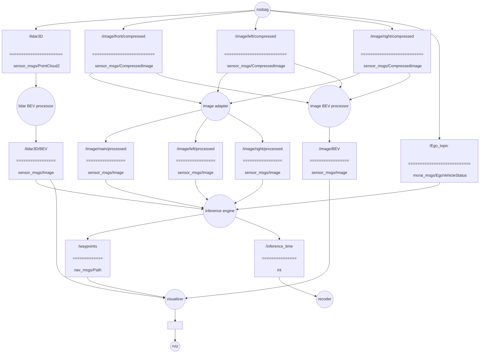

# E2E-OpenLoop-ROS-Validator
openloop validator for e2e AV models based on ROS1 noetic

TFv6 / InterFuser / DiffusionDrive v2 / SparseDrive v2 에 대응

## 0. Convention
### branch rule
main에 merge, PR하지 말것. 코드 리뷰 후에 진행.
기능 개발시 브랜치 파서 진행 합니다.
브랜치 이름은 `feature/name`를 따른다. 
- 예시: `inference_engine-data_buffer/taeyun`
### commets
코드 최상단에 코드의 역할과 구독, 발행하는 토픽을 비롯한 i/o 적기.
- 예시:
```
"""
inference engine의 인풋이 되는 데이터를 저장하는 버퍼 객체
토픽을 callback으로 객체 내부에 저장.
pub:
sub: 
    /lidar3D/BEV
    /image/main/processed
    /image/left/processed
    /image/right/processed
    /Ego_topic
"""
```

## 1. File Structure
```
E2E-OpenLoop-ROS-Validator/
├── src/
│   ├── MORAI-ROS_morai_msgs
│   └── Validator_pkg
└── rosbag/
```
코드 파일은 Validator_pkg 밑에 둘 것.
`rosbag/`에 [2026-07-16-17-13-14.bag](https://drive.google.com/drive/folders/1IBFk-q1ZYYRfLVi6TD8P2BgOuWAzudab?usp=share_link)저장.

## 2. Architecture


ROS관례에 따라 노드는 원, 토픽은 사각형으로 그림.
토픽의 ====== 위는 토픽의 이름, 아래는 토픽의 타입

### 2.1 preprocessing layer
`lidar BEV processor`, `image adaptor`, `image BEV processor` 노드로 구성됨.
raw data를 가공하여 `inference engine`과 `visualizer`에 서빙하는 계층.
- 책임: raw data를 모델이 기대하는 포멧으로 preprocessing 및 발행, visualizer가 기대하는 image BEV 가공 및 발행.
- 4개 모델에 대응 가능해야 함.

`lidar BEV processor`, `image adaptor` 노드는 모델이 기대하는 입력 포멧에 맞춰 임의로 토픽 추가, 변경.
`/image/front/compressed`, `/image/left/compressed`, `/image/right/compressed`를 stitch하는 경우 `/image/main/processed`로 발행하고 `/image/left/processed`, `/image/right/processed`는 발행하지 않도록 함.

### 2.2 inference layer
`inference engine`, `recoder`로 구성됨.
4개 모델에 대한 추론 루프. 모델의 추론 결과 waypoints를 발행한다.
`recoder`는 추론 시간을 기록. 이후 추가적인 metric을 기록하도록 확장 할 수 있도록 한다.
- 책임: 추론 루프 구동 및 waypoints 발행, 추론 시간 기록.

### 2.3 visualization layer
`visualizer`노드로 구성됨.
lidar BEV, Image BEV, waypoints를 overlap하여 시각화.
